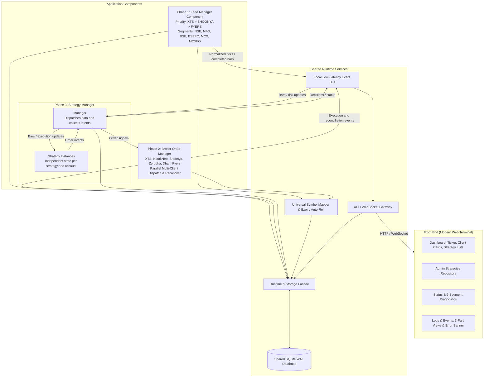

# Future-State Trading System Architecture

This document describes the proposed future-state architecture for evolving
`ftx-paper` from a paper-trading system into a multi-client trading system.
It is a design proposal, not the current implementation or an operational
runbook. The current system architecture is documented in
[Architecture](../ARCHITECTURE.md), with deployment guidance in
[Deployment](../DEPLOYMENT.md).

The first implementation should remain simple and component-based. Separate
services, process isolation, and additional broker integrations are future
extension points, not prerequisites for the initial version.

Microservices are not the default framework for every component in this
system. A service boundary will be used only where independent deployment,
scaling, or fault isolation provides a clear benefit. Components that do not
need those properties will remain modules in the main application.

---

## 🏗️ System Architecture

---

## 📦 Component Breakdown

### 1. Phase 1: Feed Manager (Component)
- **Supported Brokers:** IIFL XTS, Shoonya (Finvasia), Fyers.
- **Priority Failover:** Automatic switchover based on priority list (`["XTS", "SHOONYA", "FYERS"]`). If the primary feed experiences heartbeat timeout or socket disconnect, it seamlessly switches to the standby broker and restores all subscriptions.
- **Supported Segments:** `NSE`, `NFO`, `BSE`, `BSEFO`, `MCX`, `MCXFO`.
- **Default Subscriptions:**
  - `NSE:NIFTY` (NIFTY 50)
  - `NSE:BANKNIFTY` (BANK NIFTY)
  - `BSE:SENSEX` (SENSEX)
  - `MCX:CRUDEOIL` (Current Month Future)
  - `MCX:NATURALGAS` (Current Month Future)
  - `MCX:GOLD` (Current Month Future)
  - `MCX:SILVER` (Current Month Future)
- **Automatic Expiry Auto-Roll:** The Expiry Engine selects the next active
  contract when the current commodity future expires and updates the active
  subscription.
- **Streaming OHLC Aggregator:** Builds and stores completed `1m` bars. Higher
  resolutions (`5m`, `15m`, and `1h`) are derived from the one-minute bars.

#### Market Data Handling
Broker adapters convert historical rows and live ticks into one common
`MarketBar` format before the data reaches the event bus.

- **Historical:** Resolve instruments, fetch a small warmup period, normalize
  the bars, save them in SQLite, and load recent bars into memory.
- **Live:** Receive normalized ticks, build one-minute bars in memory, save
  completed bars in SQLite, and publish them to the local event bus. The
  runtime delivers them to the strategy.
- **Ticks:** Keep ticks in memory for aggregation and immediate stop handling;
  the first version saves completed bars, not every tick.
- **Replay:** Read the same normalized bars from SQLite.
- **Ownership:** Strategies receive data through the runtime and do not access
  the broker or database directly.
- **Failover:** Reconnect and restore subscriptions, backfill any missing
  interval, and ignore duplicate bars after switching providers.

### 2. Phase 2: Broker Order Manager (Component)
- **Role:** Accepts strategy order intents, applies account controls, and dispatches
  them to the selected account's execution adapter.
- **Default shape:** An application component owned by the API runtime. A separate
  service is only considered if there is a clear operational need.
- **Supported Brokers:** XTS, Kotak Neo, Shoonya, Zerodha, Dhan, Fyers.
- **Symbol Mapping:** Resolves canonical instruments to broker-specific symbols,
  using the Feed Manager's instrument metadata.
- **Multi-Client Routing:** Sends an independent order to each mapped account and
  records each account's result separately.
- **Paper vs. Live:** The execution mode may be set as a system default, overridden
  for a portfolio, or overridden for an individual strategy. The most specific
  setting is used for each order. Paper execution simulates fills; live execution,
  when enabled later, is the only path that submits provider orders. Paper and live
  orders and positions remain separate.
- **Controls:** Account-level and strategy-level square-off commands go through the
  API and are recorded with the resulting order, position, and audit updates.

### 3. Phase 3: Strategy Manager (Component)
- **Default shape:** An in-process component managed by the API runtime. Process
  isolation is not required for the first version.
- **Multiple strategies:** Runs multiple configured strategy instances in the same
  runtime. Each instance has its own name, parameters, lifecycle, and state, while
  sharing the Feed Manager and Order Manager.
- **Data flow:** Each strategy declares its instruments, timeframe, and lookback.
  The Manager requests normalized historical bars from the Feed Manager before
  starting it, then supplies new completed bars through the same flow. The strategy
  keeps the required history in memory for indicators such as moving averages; it
  does not access brokers or storage directly.
- **Manager and strategy operation:** The Manager dispatches bars to enabled
  strategies, collects entry/exit/adjustment intents, and sends them to the Order
  Manager. Execution results are sent back to the relevant strategy so it can update
  its state. A failure in one strategy should not stop the others.
- **Account scope:** Each strategy is assigned to one or more permitted accounts.
  The same strategy configuration can run for several accounts, with separate state
  and order results for each account.
- **Position management:** The account portfolio owns the net position, balance,
  reservations, and risk. Strategy attribution records which strategy opened or
  changed a position, but strategies do not maintain competing positions. If
  multiple strategies trade the same instrument, account-level limits and the net
  position apply to all of them.
- **Execution boundary:** Strategies emit order intents; the Order Manager selects
  the account's execution mode and owns authorization, fills, position updates, and
  persistence.
- **Paper and live:** A strategy inherits the system or portfolio mode unless it has
  an explicit mode. Paper and live execution use separate portfolios and order
  streams, so strategies under one account may use different modes without mixing
  positions. Paper positions are never treated as live positions.
- **Duplication:** Creates a new configured strategy with independent state. It does
  not copy orders or positions.

### 4. Web UI (Presentation Client)

The dashboard is a presentation client of the API/WebSocket Gateway. It uses HTTP
for page data, WebSocket events for live updates, and API commands for all actions.

The UI does not access the database, event bus, broker adapters, or strategy
components directly. It displays API projections and sends user actions through the
API, including strategy control, account actions, and square-off commands.

Users see only the accounts and portfolios permitted by their role. The active
account and portfolio context is clear when viewing positions, orders, PnL, or
strategy state.

#### Dashboard Features

1. **Header:**
    - Consolidated PnL Widget: **U** (Unrealised), **R** (Running/Realised), **T** (Total).
    - Role-based interface: **ADMIN** displays raw keys, internal names, and slugs;
      **USER** displays clean strategy names without slugs. The API determines the
      role and permissions.
2. **Streaming Ticker Row:**
    - Displays real-time prices for default instruments (`NIFTY`, `BANKNIFTY`,
      `SENSEX`, `CRUDEOIL`, `NATURALGAS`, `GOLD`, `SILVER`).
3. **Client Cards Grid:**
   - Multi-broker account status, effective Paper/Live mode, mode inherited from the
     system or portfolio where applicable, prominent **SQUARE OFF** button, and side
     drawer for:
      - Net & Day Positions
      - OrderBook with pending, rejected, partially filled, and completed orders
      - Executed Trades
      - Holdings
      - Margins & Balance Equity
4. **Strategy Lists Table:**
    - Client mapping, effective Paper/Live mode, status, last trade state, start/end
      times, U/R/T PnL with multi-leg breakdown.
    - Actions: Enable/Disable, Square Off, view charts, review trades and decision
      history, and duplicate a strategy.
5. **Strategies Page (Admin Only):**
    - Catalog of registered strategy templates.
    - Configure a strategy, assign it to permitted accounts, select its effective
      Paper/Live mode, and start or stop it.
6. **Status & Diagnostics Page:**
    - Runtime, Feed Manager, Order Manager, and Strategy Manager health.
    - Connection state, recent errors, active accounts, pending orders, and last
      update time.
    - Basic risk and operational alerts, such as margin warnings, feed failures, and
      live-mode warnings.
7. **Logs & Events Page:**
   - Three simple views:
     - 1. Broker API Log (`ERROR` / `SUCCESS`)
     - 2. Feed Subscription (`ERROR` / `SUCCESS` / `DATA_RECEIVING`)
     - 3. Strategy and execution audit timeline

## System-Wide Ownership And Operations

#### Ownership

- **Runtime:** The API process owns one active runtime and its components for each
  runtime directory. A second process must not mutate the same runtime state.
- **Storage:** The storage facade owns SQLite access and persistence for accounts,
  strategies, orders, positions, market bars, and audit events.
- **Account state:** The account portfolio is the source of truth for balances and
  positions. Strategy state provides attribution but does not replace the portfolio.
- **Client boundary:** The API/WebSocket Gateway is the only client boundary. The UI
  does not access storage or component internals.

#### Operational Responsibilities

- **Feed Manager:** Owns provider connections, historical warmup, live subscriptions,
  bar aggregation, and feed health. It does not place orders.
- **Order Manager:** Owns account routing, execution mode, orders, fills, and position
  updates. It does not generate strategy decisions.
- **Strategy Manager:** Owns strategy configuration, evaluation, and decision records.
  It consumes Feed Manager data and emits order intents.
- **Operators:** Monitor health, review errors, authorize live mode and square-off,
  and use the API rather than accessing storage or components directly.
