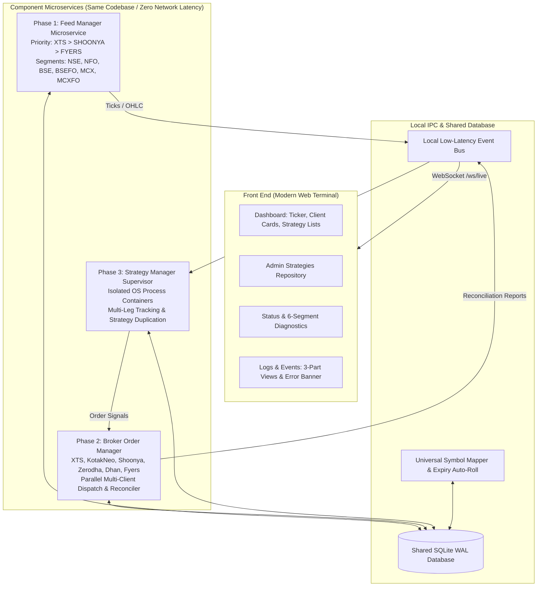

# Future-State Trading System Architecture

This document describes the proposed future-state architecture for evolving
`ftx-paper` from a paper-trading system into a multi-client trading system.
It is a design proposal, not the current implementation or an operational
runbook. The current system architecture is documented in
[Architecture](../ARCHITECTURE.md), with deployment guidance in
[Deployment](../DEPLOYMENT.md).

The first implementation should remain simple and component-based. Separate
services, process isolation, and additional broker integrations are future
extension points, not prerequisites for the initial version.

---

## 🏗️ System Architecture

---

## 📦 Component Breakdown

### 1. Phase 1: Feed Manager (Component)
- **Supported Brokers:** IIFL XTS, Shoonya (Finvasia), Fyers.
- **Priority Failover:** Automatic switchover based on priority list (`["XTS", "SHOONYA", "FYERS"]`). If the primary feed experiences heartbeat timeout or socket disconnect, it seamlessly switches to the standby broker and restores all subscriptions.
- **Supported Segments:** `NSE`, `NFO`, `BSE`, `BSEFO`, `MCX`, `MCXFO`.
- **Default Subscriptions:**
  - `NSE:NIFTY` (NIFTY 50)
  - `NSE:BANKNIFTY` (BANK NIFTY)
  - `BSE:SENSEX` (SENSEX)
  - `MCX:CRUDEOIL` (Current Month Future)
  - `MCX:NATURALGAS` (Current Month Future)
  - `MCX:GOLD` (Current Month Future)
  - `MCX:SILVER` (Current Month Future)
- **Automatic Expiry Auto-Roll:** The Expiry Engine selects the next active
  contract when the current commodity future expires and updates the active
  subscription.
- **Streaming OHLC Aggregator:** Builds and stores completed `1m` bars. Higher
  resolutions (`5m`, `15m`, and `1h`) are derived from the one-minute bars.

#### Market Data Handling
Broker adapters convert historical rows and live ticks into one common
`MarketBar` format before the data reaches the event bus.

- **Historical:** Resolve instruments, fetch a small warmup period, normalize
  the bars, save them in SQLite, and load recent bars into memory.
- **Live:** Receive normalized ticks, build one-minute bars in memory, save
  completed bars in SQLite, and publish them to the local event bus. The
  runtime delivers them to the strategy.
- **Ticks:** Keep ticks in memory for aggregation and immediate stop handling;
  the first version saves completed bars, not every tick.
- **Replay:** Read the same normalized bars from SQLite.
- **Ownership:** Strategies receive data through the runtime and do not access
  the broker or database directly.
- **Failover:** Reconnect and restore subscriptions, backfill any missing
  interval, and ignore duplicate bars after switching providers.

### 2. Phase 2: Broker Order Manager (Independent Module)
- **Supported Brokers:** XTS, Kotak Neo, Shoonya, Zerodha, Dhan, Fyers.
- **Universal Symbol Mapping:** Unified canonical token resolver (`NSE:NIFTY`, `NFO:...`, `MCX:...`) mapping to broker-specific trading symbols and exchange tokens across all 6 brokers.
- **Parallel Multi-Client Routing:** When a single strategy generates a signal mapped to multiple client accounts, orders are fired concurrently with zero head-of-line blocking.
- **Paper vs. Live Execution Mode:** Per-account mode switch with simulation of fills, slippage, and margins.
- **Order Reconciliation Engine:** Processes WebSocket and Webhook execution reports, syncing positions and trade records.
- **Prominent Emergency Square-Off:** Single-click square-off available at both Account level and Strategy level.

### 3. Phase 3: Strategy Manager (Independent Module) Core Module
- **Process Container Isolation:** Each strategy instance runs inside an isolated OS process (`multiprocessing.Process`). A fault, unhandled exception, or code modification in one strategy will **never** disturb another strategy or crash the engine.
- **Multi-Leg Price Tracking:** Tracks entry, exit, and real-time PnL across all legs (e.g. 0DTE Short Straddles with Call & Put legs).
- **Strategy Duplication:** Clones tested strategy templates with customized parameters or symbols while maintaining separate runtime state.
- **Chronological Decision Trail:**
  1. `Candle Fetch Success`
  2. `ENTRY CONDITION MATCH / NOT MATCH`
  3. `ORDER SENT TO BROKER`
  4. `ORDER FILLED / FAILED`
  5. `TRADE ACTIVE`
  6. `TRACKING SL / TARGET`

---

## 🖥️ Web Trading Dashboard Features

1. **Header:**
   - Consolidated PnL Widget: **U** (Unrealised), **R** (Running/Realised), **T** (Total).
   - Role Switcher: **ADMIN** (displays raw keys, internal names, and slugs) vs **USER** (displays clean strategy names without slugs).
   - Theme Switcher: Seamless Dark and Light theme toggle.
   - Live WebSocket pulse indicator.
2. **Streaming Ticker Row:**
   - Default instruments (`NIFTY`, `BANKNIFTY`, `SENSEX`, `CRUDEOIL`, `NATURALGAS`, `GOLD`, `SILVER`) with real-time green/red tick direction flashing.
3. **Client Cards Grid:**
   - Multi-broker account status, Paper/Live switcher, prominent **SQUARE OFF** button, and side drawer for:
     - Net & Day Positions
     - OrderBook
     - Executed Trades
     - Holdings
     - Margins & Balance Equity
4. **Strategy Lists Table:**
   - Client mapping, status, last trade state, start/end times, U/R/T PnL with multi-leg breakdown.
   - Action Menu: Enable/Disable, Square Off, Interactive Candlestick/Line Chart modal, Recent Trades modal, Decision Audit Timeline modal, Duplicate modal.
5. **Strategies Page (Admin Only):**
   - Catalog of registered strategy templates ready to deploy to client accounts.
6. **Status & Diagnostics Page:**
   - Feed Manager Health Card with latency, packets, and Manual Failover button.
   - **Diagnostic Test Cases Suite:**
     - Test 1: Symbol Subscription & OHLC fetch for 1 symbol across all 6 segments (`NSE`, `NFO`, `BSE`, `BSEFO`, `MCX`, `MCXFO`).
     - Test 2: Real-time order execution test across all 6 segments.
7. **Logs & Events Page:**
   - Clean, zero-noise interface with 3 tabs:
     - 1. Broker API Log (`ERROR` / `SUCCESS`)
     - 2. Feed Subscription (`ERROR` / `SUCCESS` / `DATA_RECEIVING`)
     - 3. Strategy Decision Log
   - **High-Visibility Prompt Error Banner:** Prominently highlights critical issues at the top of the page with a **DISMISS** action so errors are immediately resolved.
